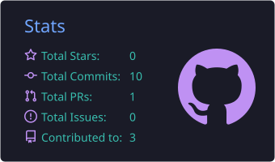
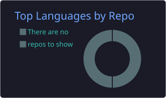
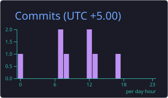

<!--
  PROFILE README: sukanta7076/sukanta7076  (repository must be PUBLIC)

  Needs two GitHub Actions workflows to be run once:
    .github/workflows/snake.yml                    -> creates the "output" branch (snake)
    .github/workflows/profile-summary-cards.yml    -> creates /profile-summary-card-output (stats cards)
-->

<div align="center">


<a href="https://github.com/sukanta7076">
  
</a>

<br /><br />


</div>

<br />


<div align="center">
  
</div>

<p align="center">
  I'm a <b>Full Stack Developer</b> who builds web applications end to end.<br />
  I enjoy designing clean REST APIs, securing them properly, and shipping them to the cloud.<br />
  Day to day I work with <b>Java</b>, <b>Spring Boot</b>, <b>React</b>, <b>Node.js</b> and <b>databases</b>,<br />
  and I'm always looking for ways to write software that is simpler to run, test and scale.
</p>

```java
public class Sukanta {
    String role     = "Full Stack Developer";
    String focus[]  = { "Spring Boot", "REST APIs", "React", "Node.js", "Databases" };
    String security = "JWT, RBAC";
    String shipping = "Docker, GitHub Actions, Azure";
    String mindset  = "Build it clean. Make it scale.";
}
```


<div align="center">
  
</div>

<div align="center">

<br />


<br />

<br />


<br />


<br />


<br />

<br />


<br />

<br />


<br />


</div>

<br />


<div align="center">
  
</div>

<p align="center">
  
  
  
</p>

<p align="center">
  <sub>
    Going deeper on Java backend engineering and Spring Boot, learning the fundamentals of system design,<br />
    and practising how to build applications that stay reliable as they grow.
  </sub>
</p>


<div align="center">
  
</div>

<!-- Streak card: public service, works independently of the Actions below. -->
<!-- Cards below are generated by YOUR OWN workflow (profile-summary-cards.yml) and appear after its first run. -->
<div align="center">


<br />






</div>


<div align="center">
  
</div>

<!-- This image only appears after the "snake.yml" workflow has run once and created the "output" branch. -->
<div align="center">
  <picture>
    <source media="(prefers-color-scheme: dark)" srcset="https://raw.githubusercontent.com/sukanta7076/sukanta7076/output/github-contribution-grid-snake-dark.svg" />
    <source media="(prefers-color-scheme: light)" srcset="https://raw.githubusercontent.com/sukanta7076/sukanta7076/output/github-contribution-grid-snake.svg" />
    
  </picture>
</div>


<div align="center">
  
</div>

<p align="center">
  <a href="https://www.linkedin.com/in/sukanta-kundu-92471a250/"></a>
  <a href="mailto:kundu.sukanta.9641@gmail.com"></a>
  <a href="https://github.com/sukanta7076"></a>
</p>

<div align="center">
  
</div>


